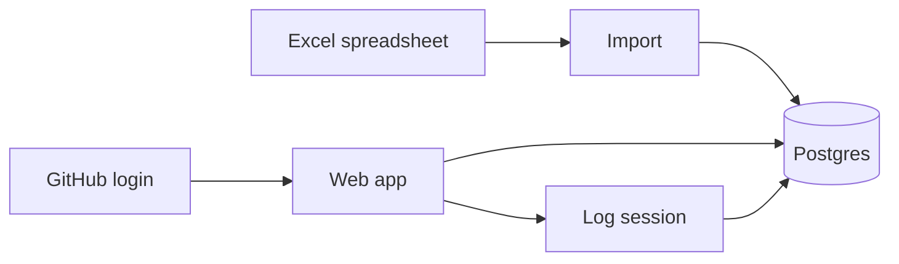
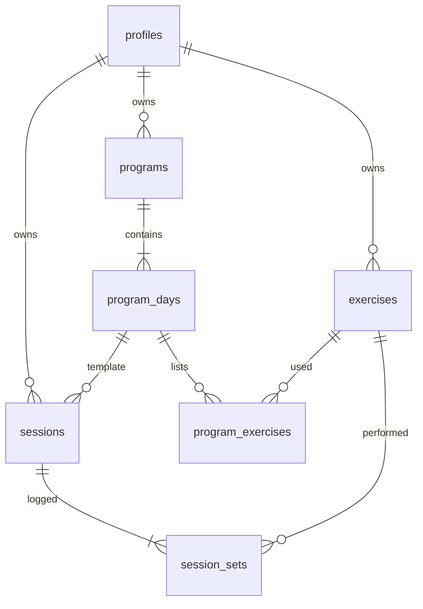

# Personal Trainer — Product Requirements Document

Working title: **Personal Trainer**  
Status: Phase 1 in use (Vite SPA + Supabase); destination TanStack Start  
Language: English  
Audience: single user (the owner)

This document defines what to build and in what order. Stack choices live in [tech-stack.md](./tech-stack.md).

---

## 1. Problem

Progress is tracked today in an Excel spreadsheet, updated in real time during home-gym sessions. That works, but it is a poor long-term system:

- History, programs, and daily logging live in one fragile file.
- There is no first-class notion of a program (split days, exercise order, target sets/reps) separate from a session log.
- Charts, a diet planner, and an AI assistant are planned, but they should not be bolted onto a spreadsheet.
- The same data should be reachable from a computer (primary) and a phone (secondary) without paying for software.

The product replaces the spreadsheet as the system of record, after importing existing history.

## 2. Goals

- Log workouts **during the session**, at home, primarily on desktop, with a layout that feels as fast as filling Excel.
- Store **date, program/split, exercise, sets, reps, and weight**.
- Support a **fixed program**: same exercises, progressing load.
- **Import existing Excel history** in v1 so nothing is left behind.
- Run as a **hosted website** with **GitHub login**, at **$0** (free tiers only).
- Keep the data model and UI ready for later visualizations, diet, and a BYOK AI assistant — without building those now.

## 3. Non-goals (v1)

v1 is not:

- Diet tracking or a meal planner
- An AI coach or chatbot
- Progress photos
- RPE / RIR, rest timers, tempo, or cardio
- Body weight or body measurements
- Native iOS / Android apps
- Multi-user coaching, trainer sharing, or public profiles
- Using Google Sheets / Excel as a live backend after import
- Offline-first / PWA (online-only is accepted for v1)
- Paid APIs, paid hosting, or any feature that requires a credit card

## 4. User

| Attribute | Decision |
|---|---|
| Who | Only the owner |
| Where | Home gym |
| When | In real time while training |
| Primary device | Desktop |
| Secondary device | Phone (same account, same data) |
| Training style | Fixed program (progress load on known exercises) |
| Language | English |
| Cost constraint | Pay nothing |

There are no other roles in v1. Auth is allowlisted to one GitHub account so a public URL is not an open signup.

## 5. Product decisions

| Topic | Decision |
|---|---|
| Product type | Responsive web app, desktop-first |
| Access | Hosted website + GitHub login |
| Sync | Same data on desktop and phone via the hosted backend |
| Units | Kilograms by default (lb can be added later) |
| v1 tracking | Date, program/split, exercise, sets, reps, weight |
| History | Must import the current Excel file |
| Charts / diet / AI | Roadmap only (phases 2–4) |

## 6. What v1 is

A fast, spreadsheet-like workout logger in the browser:

1. Sign in with GitHub (allowlisted to the owner’s account).
2. Import Excel history into the database.
3. Define a program (for example PPL) and its days and exercises.
4. Start today’s session from that program and log sets, reps, and weight while training.
5. Browse past sessions and see a **last time you did this exercise** hint (weight × reps) so load can progress. Dashboard and Charts cover 90-day volume and movers.

## 7. User stories (v1)

### Auth

- As the owner, I can sign in with GitHub and land on my data.
- As a random visitor, I cannot create a useful account or see anyone’s workouts.

### Program

- As the owner, I can create a program with named split days (e.g. Day 1–4).
- As the owner, I can put exercises on a day in a fixed order, with a default sets × reps target, and skip weight on bodyweight lifts.
- As the owner, I can add, rename, reorder (arrows or drag-and-drop), and remove exercises on a day without deleting historical sessions.
- As the owner, I can assign a weekday to some or all program days (for example Day 1 always Monday, Day 4 always Friday), and choose whether to move existing history onto those weekdays.

### Logging

- As the owner, I can start a session for today from a program day and see the day’s exercises pre-filled.
- Imported history dated today does not take over the Today logger; Today is the live session.
- As the owner, I can enter set number, reps, and weight as quickly as in Excel (keyboard-friendly table on desktop).
- As the owner, I can mark a session done only after at least one filled set, or delete today’s session and return to Start.
- As the owner, I can see, for each exercise, what I lifted the last time I performed it.

### History

- As the owner, I can open past sessions by date and by program day, with filters and pagination.
- As the owner, I can edit a set I mistyped, or change a session’s date.
- One calendar day is one session. History never keeps two workouts on the same date.

### Import

- As the owner, I can upload my Excel file once and get historical sessions in the app, mapped to exercises and dates.
- As the owner, I can preview the mapped rows and confirm before anything is written.
- As the owner, I can see a clear error if a row cannot be mapped (missing date, non-numeric weight, unknown column).

## 8. Data model (v1)

Units are stored as **kg**. This stays close to a spreadsheet so import is a column mapping, not a new way of training.

| Table | Purpose | Key fields |
|---|---|---|
| `profiles` | Owner row tied to GitHub auth | `id` (auth user), `github_username` |
| `programs` | A named plan | `id`, `user_id`, `name` (e.g. “PPL 6-day”) |
| `program_days` | Split day inside a program | `id`, `program_id`, `name` (e.g. “Day 1”), `sort_order`, `weekday` (optional ISO 1–7, Monday–Sunday) |
| `exercises` | Canonical exercise names | `id`, `user_id`, `name`, `muscle_group` (optional) |
| `program_exercises` | Exercise on a day | `id`, `program_day_id`, `exercise_id`, `sort_order`, `target_sets`, `target_reps`, `uses_weight` |
| `sessions` | One workout | `id`, `user_id`, `program_day_id` (nullable for imported leftovers), `performed_on` (date), `status` (`in_progress` / `done`) |
| `session_sets` | One set | `id`, `session_id`, `exercise_id`, `set_number`, `reps`, `weight_kg`, `note` (optional, unused in UI for v1 except import leftovers) |

Rules:

- Deleting a program day must not delete past `sessions`.
- Deleting an exercise that appears in history is not allowed; archive/hide instead if needed later.
- One session per calendar date (home gym). Duplicate dates are split; a date that already has a session cannot be saved again.
- `weekday` is optional per program day. Saving it does not change history until the owner confirms **Update history**.
- `session_sets.weight_kg` is numeric; a filled set is `reps > 0`. Skip-weight lifts omit load.

## 9. Excel import

v1 **must** import the existing spreadsheet so history is not abandoned. Two layouts are supported.

### Tall log

| Spreadsheet column | Maps to |
|---|---|
| Date | `sessions.performed_on` |
| Workout / split / day | `program_days.name` (create program + days as needed) |
| Exercise | `exercises.name` (match case-insensitive; create if missing) |
| Set | `session_sets.set_number` |
| Reps | `session_sets.reps` |
| Weight | `session_sets.weight_kg` |

### Average To Jacked (wide)

Sheets named Day 1, Day 2, … . Each **column** is one training cycle. Day 1, Day 2, Day 3 of the same column are consecutive calendar days. The next column is the next cycle. Weight comes from the kg band above the column. The workout-goal column is skipped. Dates in the sheet are used when present; otherwise columns are packed toward today.

### Import behaviour

1. Upload `.xlsx` (and `.xls` / `.csv` if cheap to support).
2. Show a preview: detected headers, sample rows, proposed mapping.
3. Allow the owner to remap columns before commit (tall files).
4. Group rows into sessions by date + split day.
5. Create missing exercises and program days rather than failing the whole file.
6. Do not duplicate if the same date + day + exercise + set is imported twice (idempotent on that tuple).
7. Do not store a day with zero filled sets. One calendar day is one session; colliding dates are bumped.
8. After a successful import, Excel is an archive. The app is the system of record. Optional program weekdays can then be applied to history from Programs.

## 10. UX

### Desktop (primary)

- Session logging is a **table**, not a wizard: one row per set, tab between cells, Enter to move down.
- Program day exercises are pre-filled as empty set rows (or last-time weights as placeholders — last-time is visible, not auto-submitted).
- Navigation: Dashboard / Today / Programs / History / Charts / Import.
- Dashboard and Charts volume/movers use the last **90 days** unless the owner changes the Charts range.
- Program exercises reorder with arrows and animated drag-and-drop.
- Density should be closer to a spreadsheet than to a marketing site.

### Mobile (supported)

- Same routes and data.
- Table stacks or becomes a compact card per exercise with set rows inside.
- Must be usable to glance at last time and log a set; it does not have to match desktop speed.

### Copy

English only. No empty-state jokes; empty states say what to do next (create a program, import Excel, start today’s session).

## 11. Non-functional requirements

| Requirement | Target |
|---|---|
| Cost | $0 — free tiers only; no paid APIs in v1 |
| Availability | Online-only is acceptable |
| Auth | GitHub OAuth, allowlist of one username |
| Authorization | Row Level Security: only the owner’s `user_id` |
| Locale | English UI and docs |
| Units | kg stored and displayed |
| Privacy | Personal training data; public URL must not leak sessions |
| Performance | Logging a set should feel instant (local optimistic update is fine) |
| Backup | Postgres is the store; export (JSON/CSV) is a later nice-to-have, not v1 |

## 12. Roadmap

### Phase 0 — Documentation (done)

- This PRD
- [tech-stack.md](./tech-stack.md)

### Phase 1 — Logger (in use)

- GitHub auth + allowlist
- Schema above with RLS
- Program and day editor, weekday assignment, exercise drag-and-drop
- Session logger (desktop table, mobile-usable)
- Last-time hint per exercise
- History list + session detail + date edit
- Excel import (ATJ wide sheets and tall logs)
- Dashboard 90-day volume and top movers; Charts page

### Phase 2 — Visualizations (more of)

- Richer volume / estimated 1RM / PR views
- Optional bodyweight series if that data is added
- Charts via **TanStack Charts** (see [tech-stack.md](./tech-stack.md))

### Phase 3 — Diet planner

- Separate module, same login and database
- Does not change how sets are logged

### Phase 4 — AI assistant

- Owner pastes an API key in settings (bring your own key)
- Key is stored as a Worker secret and called from a TanStack Start server function — never committed, never shipped to the client
- Uses logged sessions (and later diet) as context
- No AI spend on the project’s bill

Phase 2+ must not require a rewrite of programs, sessions, or sets. New tables and new routes only.

## 13. Success criteria (v1)

v1 is done when the owner can:

1. Open the hosted URL, sign in with GitHub, and only their account works.
2. Import the Excel history and recognize their past sessions in History.
3. Define the current fixed program.
4. Log a live home-gym session on desktop as quickly as in Excel.
5. See last-time weight/reps for each exercise.
6. Open the same session on a phone.

## 14. Open questions

Resolved: ATJ sheet layout is in §9. Imported programs default to **Home routine**. Working title stays **Personal Trainer**.
