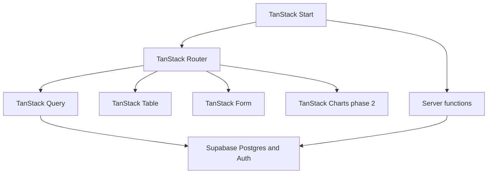
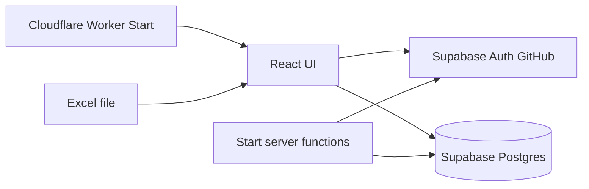

# Personal Trainer — Tech stack

Status: Phase 1 scaffold (Vite SPA); destination is TanStack Start  
Companion: [prd.md](./prd.md)

This is the decision record for how the product is built. It exists so later phases plug in without a rewrite.

**Constraints that drove the stack:** $0, hosted URL, GitHub login, SQL (spreadsheet-shaped data), desktop-quality tables, phone as a second client, **TanStack as the application layer**.

**Current vs destination:** the clickable UI is a Vite + React Router SPA with in-memory data. Destination remains **TanStack Start** on Cloudflare Workers + Supabase. Do not treat the SPA as the long-term app shell.

---

## 1. Decision table

| Layer | Choice | Why |
|---|---|---|
| Package manager | **pnpm** | Lockfile is `pnpm-lock.yaml`. Do not use npm or yarn. |
| App | **TanStack Start** (React + TypeScript) | Full-stack Vite framework: type-safe routing, SSR, server functions. Official Cloudflare path. |
| Router | **TanStack Router** | Comes with Start; file routes, typed search params, loaders |
| Server state | **TanStack Query** | Cache, mutations, optimistic set logging |
| Tables | **TanStack Table** | Spreadsheet-like session logger on desktop |
| Forms | **TanStack Form** | Program / exercise editors with typed fields |
| Charts (phase 2) | **TanStack Charts** (`@tanstack/charts`) | Same family as the rest of the UI; typed marks, no extra chart vendor |
| UI primitives | **[shadcn/ui](https://ui.shadcn.com/)** + **Tailwind CSS** | Official registry; copy into `src/components/ui`. Style: radix-nova (`components.json`). |
| Lint / format | **[Biome](https://biomejs.dev/)** | One tool for lint + format. Config: `biome.json`. No ESLint, Prettier, or oxlint. |
| Backend | **Supabase** (Postgres + Auth + Row Level Security) | GitHub login and a real database in one free project |
| Hosting | **Cloudflare Workers** | Official TanStack Start partner; free tier; not static Pages (Start needs a server) |
| Excel | **SheetJS community (`xlsx`)** | Client-side import, no paid service |
| AI (phase 4) | **BYOK** via a Start **server function** | Owner provides the key; it never ships to the browser or git |

TanStack Start is stable. Use current `@tanstack/react-start` with matching `@tanstack/*` package versions.

## 2. TanStack suite — what each piece does here



| Library | Phase | Use |
|---|---|---|
| Start | 1 | App shell, Vite build, SSR of the authenticated layout, deploy target |
| Router | 1 | Routes: today, programs, history, import (later: charts, diet, settings) |
| Query | 1 | Sessions, sets, programs; optimistic updates when logging a set |
| Table | 1 | Dense set logger (one row per set, keyboard tab between cells) |
| Form | 1 | Create/edit program days and exercises |
| Charts | 2 | Volume, estimated 1RM, PRs — `defineChart` + React `Chart` |
| Virtual | later, only if needed | Long history lists; do not add in v1 |

Do not add Next.js or a second chart library. React Router is only in the current Vite scaffold; drop it when migrating to Start. If a TanStack library covers the job, use it.

## 3. Why these, not the alternatives

### Why TanStack Start instead of a Vite SPA + React Router

The owner prefers TanStack. Start is Router plus the pieces this app will actually need: typed routes, loaders, and **server functions** (Excel batch import helpers, GitHub allowlist checks, phase 4 AI so the API key stays on the server). A SPA would force a later migration.

SSR of public marketing pages is irrelevant. SSR of the app shell is fine. React Server Components are **not** required; keep Query + client components for the logger.

### Why not Next.js

Start replaces it. Same class of framework, aligned with Router / Query / Table. No App Router, no RSC-first data layer.

### Why not SQLite only in the browser

The owner needs the **same data on desktop and phone** with a free login. Postgres + GitHub auth is fewer moving parts than a custom sync layer.

### Why not Firebase / Google Sheets as the live backend

Firestore is a poor fit for “session has many sets” and Excel-shaped queries. Sheets/Excel are an **import source once**, then archive.

### Why Cloudflare Workers, not Pages

TanStack Start is not a static SPA. Cloudflare’s documented target is **Workers** (`@cloudflare/vite-plugin` + `wrangler`, `main: "@tanstack/react-start/server-entry"`). Workers’ free tier stays inside the $0 constraint.

### Why not native mobile, paid hosting, or paid auth

Home gym, desktop first. A responsive Start app covers the phone. Paid auth/hosting/AI fail the $0 rule.

### Why shadcn/ui (https://ui.shadcn.com/)

Owned primitives in the repo, Tailwind tokens, no extra runtime UI kit. Matches dense tables and dialogs without fighting TanStack Table. Do not add a second component library.

### Why Biome (https://biomejs.dev/)

One linter and formatter. Faster than ESLint + Prettier, one config file. Do not add ESLint, Prettier, or oxlint.

## 4. Architecture



- **TanStack Start** runs on a **Cloudflare Worker** (SSR + server functions + static assets).
- The browser uses the **Supabase JS client** for GitHub OAuth and CRUD. **RLS** is the authorization layer.
- **TanStack Query** wraps every Supabase read/write used by the UI.
- Excel is parsed **in the browser** with SheetJS, then inserted through Query (a server function may batch-insert if the file is large).
- There is **no Express/Node API**. If the server must run code, it is a Start server function.

v1 default: client + RLS. Server functions are available from day one but are not a second backend.

## 5. Data and security

Schema is defined in [prd.md](./prd.md) §8. Implementation notes:

- Enable **GitHub** as the only auth provider.
- **Allowlist** one GitHub username (env or a small `allowed_users` table checked in RLS or a Start middleware). Random visitors who sign in with another GitHub account get no rows and cannot insert.
- Every table except auth internals has `user_id` and policies: `user_id = auth.uid()`.
- `profiles` is created on first successful allowlisted login.
- The Supabase anon key ships in the client. **RLS is mandatory.**
- Phase 4 API keys live in Wrangler secrets / local env and are read only inside a server function (`cloudflare:workers` `env` on Workers — not `process.env` at module scope).

## 6. Environment variables

Never commit secrets. Local `.env` for Vite/Start; Wrangler vars/secrets in production.

| Variable | Where | Purpose |
|---|---|---|
| `VITE_SUPABASE_URL` | client | Supabase project URL |
| `VITE_SUPABASE_ANON_KEY` | client | Supabase anonymous/public key |
| `ALLOWED_GITHUB_USERNAME` | Supabase and/or Worker env | Owner allowlist |
| `AI_API_KEY` (phase 4) | Worker **secret** only | BYOK; never `VITE_*` |

No service-role key in the client. If a one-off admin task needs it, use the Supabase dashboard or a local script that is not deployed.

On Cloudflare Workers, do not read `process.env` at module scope. Inside server functions use `import { env } from "cloudflare:workers"` (or per-request `process.env` in a handler).

## 7. Local and production setup (outline)

Phase 1 implementation will follow this outline; this doc does not run it yet.

### Local

1. Create a free Supabase project.
2. Enable GitHub OAuth (GitHub OAuth App callback → Supabase).
3. Apply SQL migrations for tables + RLS + allowlist.
4. Scaffold **TanStack Start** (`@tanstack/react-start`) with the Cloudflare Vite plugin.
5. `pnpm dev` (`vite dev`) with the two `VITE_*` variables.
6. Sign in, import a copy of the Excel file, log a test session.

### Production

Current app is a Vite SPA. GitHub Actions (`.github/workflows/pipeline.yml`) on `main` runs **typecheck → build → `wrangler deploy`** (static assets Worker). Pull requests run typecheck and build only. Config: `wrangler.jsonc`.

Repo secrets (Settings → Secrets and variables → Actions):

| Secret | Where |
|---|---|
| `CLOUDFLARE_API_TOKEN` | Cloudflare profile → API Tokens. Template **Edit Cloudflare Workers**, or custom: Account → Cloudflare Pages → Edit |
| `CLOUDFLARE_ACCOUNT_ID` | Cloudflare dashboard → any domain/Workers overview (right sidebar) |
| `VITE_SUPABASE_URL` | Same value as local `.env` |
| `VITE_SUPABASE_ANON_KEY` | Same value as local `.env` (anon/publishable only) |

First production URL is `https://personal-trainer.<subdomain>.workers.dev`. Point Supabase Auth Site URL and the GitHub OAuth app homepage at that URL after the first deploy.

If Cloudflare **Workers Builds** is also connected to this repo, pause it (Workers & Pages → personal-trainer → Settings → Builds) so only GitHub Actions deploys. Otherwise the two pipelines overwrite each other.

When the app moves to TanStack Start, keep `wrangler deploy` and add a Worker entry; the same secrets stay.

### Cost

All of the above is on free tiers: Cloudflare Workers, Supabase Free, GitHub OAuth, SheetJS community, TanStack (open source).

## 8. Free-tier limits and caveats

### Supabase Free

- Postgres + Auth + a hosted API are included.
- A free project can **pause after 7 days of inactivity**. Regular training keeps it awake. After a pause, resume it from the Supabase dashboard; data is not deleted.
- Storage and request limits on Free are far above one person’s gym log.

**Escape hatch:** if pause-on-idle becomes annoying, move the database to **Cloudflare D1** (SQLite) and keep the same Start app. Server functions already run on the Worker, so D1 is a smaller jump later. Do not build D1 now.

### Cloudflare Workers

- Official host for TanStack Start.
- Free tier is enough for one user.
- Use the Cloudflare Vite plugin; do not deploy Start as a static Pages project.

### SheetJS community

- Enough to read `.xlsx` in the browser.
- Do not use the paid build.

### TanStack Charts

- Phase 2 only. Latest published line is 1.x (`@tanstack/charts` + `@tanstack/charts/react`).
- Pin a version and read that release’s docs; do not mix unreleased `main` APIs.

## 9. UI and tooling

### shadcn/ui

- Registry: **https://ui.shadcn.com/**
- Copy components into the repo with `pnpm dlx shadcn@latest add <name>`. No paid registry.
- Config: `components.json` (style `radix-nova`, Tailwind CSS in `src/index.css`, icons: lucide).
- Import from `@/components/ui/*`. If a primitive exists (Button, Input, Dialog, Select, Badge), use it — do not add MUI, Chakra, Ant, Daisy, or a second button kit.
- Theme: light zinc/emerald via CSS variables. Dark mode can wait; stay consistent.

### TanStack widgets

- **TanStack Table** for the session logger: keyboard tab between cells, one row per set, dense on desktop.
- **TanStack Form** for program setup, not for every individual set (sets stay in the table).
- **TanStack Charts** in phase 2: line/bar charts of volume and best sets from `session_sets`. No Recharts.
- Mobile: same routes and Query data; table stacks or becomes a compact card per exercise.

### Biome

- Linter and formatter: **https://biomejs.dev/** (`@biomejs/biome`, `biome.json`).
- Scripts: `pnpm lint`, `pnpm lint:fix`, `pnpm format`.
- Do not add ESLint, Prettier, oxlint, or a second formatter.
- Cursor rules live in `.cursor/rules/` (`stack.mdc`, `shadcn-ui.mdc`, `biome.mdc`).

## 10. How later phases plug in

No rewrite of programs, sessions, or sets.

| Phase | Add | Do not change |
|---|---|---|
| **2 Visualizations** | Routes under Start + **TanStack Charts** reading `session_sets` | Logger UX, schema of sets (views/aggregates only) |
| **3 Diet** | New tables (`foods`, `meals`, …) and Start routes | Workout tables |
| **4 AI** | Settings field + Start **server function** holding the API key in a Worker secret | Key must never be committed or exposed as `VITE_*`; no project-paid model |

Charts and diet only **read** (or add adjacent tables to) the Phase 1 model. The AI assistant uses the same login and the owner’s key.

## 11. Out of scope for the stack

- Native iOS / Android
- Paid hosting, paid auth, paid analytics
- Google Sheets as a live backend
- Next.js, Remix (React Router only until the Start migration)
- Recharts / Chart.js / other chart kits
- MUI, Chakra, Ant Design, DaisyUI, or a second component kit
- ESLint, Prettier, oxlint (Biome is the only linter/formatter)
- A custom Node/Express API
- Offline-first PWA (can be revisited if gym use ever needs it)
- React Server Components as the data layer
- Storing AI keys in git, in the client bundle, or in Supabase in plaintext
- Deploying Start as a static Cloudflare Pages site

## 12. Repo layout

Current scaffold (Vite SPA). Start migration will replace `src/pages` + React Router with `src/routes` and add `wrangler.jsonc` + `supabase/migrations/`.

```
docs/prd.md
docs/tech-stack.md
.github/workflows/pipeline.yml
wrangler.jsonc
.cursor/rules/
  stack.mdc
  shadcn-ui.mdc
  biome.mdc
biome.json
components.json
src/
  pages/               # today, programs, history, import (Router until Start)
  components/
    ui/                # shadcn/ui primitives
    app-shell.tsx
    set-logger.tsx
  lib/
vite.config.ts
```
